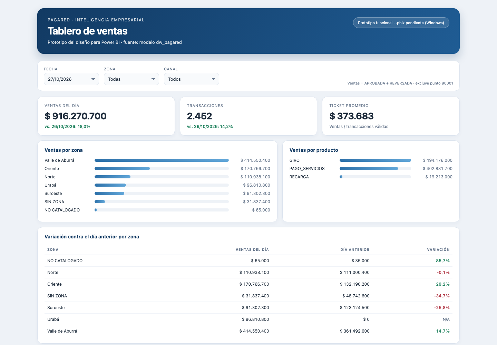

<div class="cover">
  <div class="brand">PagaRed S.A.S. · Grupo Réditos</div>
  <h1>Informe consolidado</h1>
  <div class="subtitle">Prueba Técnica — Desarrollador de Arquitectura de Software</div>
  <div class="meta">
    <strong>Candidato:</strong> Jhon E.<br>
    <strong>Fecha de corte:</strong> 27 de octubre de 2026<br>
    <strong>Entrega:</strong> 14 de noviembre de 2026<br>
    <strong>Rol:</strong> Desarrollador de Arquitectura de Software
  </div>
  <div class="repo">
    <strong>Repositorio</strong><br>
    <code>https://github.com/jhoney787813/test-arquitectura-prueba-tecnica-pagared.git</code><br><br>
    <strong>Clonar</strong><br>
    <code>git clone https://github.com/jhoney787813/test-arquitectura-prueba-tecnica-pagared.git</code>
  </div>
  <div class="nota">Documento confidencial · uso exclusivo del proceso de selección</div>
</div>


# Conclusiones del candidato: lo que no se ve en el repositorio

Antes de la solución técnica, quiero ser explícito en algo que no cabe en un
diagrama ni en un test unitario: saber SQL, Python, arquitectura o Power BI es
necesario, pero no suficiente para este rol. La diferencia entre un ejercicio
correcto y un compañero de equipo confiable está en cómo se responde cuando
algo falla a las 2:00 a. m., cuando un ticket urgente compite con el trabajo
planeado, cuando el negocio no entiende una decisión técnica y cuando uno
necesita ayuda y debe pedirla sin ego.

En operación, la atención a incidentes no es “apagar el fuego”: es asumir el
incidente, comunicar el estado con honestidad, separar el síntoma de la causa
raíz, corregir los datos si quedaron mal y dejar una prevención que evite que
vuelva a pasar. En esta prueba eso se ve en el análisis de `carga_recaudos_bi`:
no basta con decir “el job está en verde”; hay que leer los logs, los archivos
de control, el historial de Power BI y el tiempo del agente para encontrar que
se cargó una sola parte del archivo y que el tablero refrescó a mitad de la
carga. Esa curiosidad y esa disciplina son las que aplico en incidentes reales.

En tickets de alta prioridad, mi prioridad es el impacto en el negocio, no el
orden de llegada: entender qué se está cayendo, a quién afecta, qué mitigación
inmediata existe y cuándo se comunicará el siguiente avance. Un ticket no
termina cuando el código compila; termina cuando el usuario confirma que puede
trabajar y cuando queda la evidencia para que otro no tenga que empezar de
cero. La documentación de este repositorio —runbook, resultados, decisiones y
aprobaciones— es la misma disciplina que aplico a un ticket.

La comunicación también es parte del trabajo. Traducir “UTC, SCD2 o idempotencia”
a “el reporte llega a las 6:00, no se duplica y el histórico no cambia” es lo
que permite que Laura, Finanzas o un evaluador tomen decisiones. Preguntar
antes de asumir, documentar el supuesto y decir “esto no lo sé todavía, pero
así lo voy a verificar” es más valioso que una respuesta rápida y falsa.

Y sí: pido ayuda. No creo que pedir una segunda opinión, escalar un bloqueo o
reconocer que otro sabe más sea una debilidad; es la forma de no convertir un
problema pequeño en un incidente. En esta prueba corregí el rumbo varias veces:
acepté que el plan monolítico no era la mejor unidad de trabajo, que el `OR`
que propuse para A1 no resolvía el LEFT JOIN y que la estructura inicial no era
la que necesitaba para sustentar el entregable. Esa humildad para corregir es,
para mí, parte del criterio técnico.

Pido al reclutador que, antes de cualquier filtro o prueba técnica, pondere
también estas habilidades: atención a incidentes, resolución de tickets críticos,
comunicación con negocio y técnicos, y disposición a pedir ayuda. El
repositorio demuestra lo que sé construir; esta conclusión explica cómo trabajo
cuando la construcción se encuentra con la realidad.


# Ficha del entregable

| Campo | Valor |
| :--- | :--- |
| Candidato | Jhon E. |
| Empresa del caso | PagaRed S.A.S. — Grupo Réditos |
| Rol | Desarrollador de Arquitectura de Software |
| Fecha de corte | 27 de octubre de 2026 |
| Fecha de entrega | 14 de noviembre de 2026 |
| Repositorio | [github.com/jhoney787813/test-arquitectura-prueba-tecnica-pagared](https://github.com/jhoney787813/test-arquitectura-prueba-tecnica-pagared.git) |
| Stack | Python 3.11, pandas, openpyxl, SQLite, pytest, ruff, Podman |
| Entregable | Pipeline ETL, modelo dimensional, SQL, revisión B4, operación B5 y diseño/prototipo B6 |

**Clonar y ejecutar:**

```bash
git clone https://github.com/jhoney787813/test-arquitectura-prueba-tecnica-pagared.git
cd test-arquitectura-prueba-tecnica-pagared
make setup        # Python 3.11 + dependencias
make test         # 65 pruebas
make podman-demo  # contenedor: tests, ETL, SQL, BI y envío B4
```

**Qué incluye:** informe, datos del kit, pipeline idempotente, reporte Excel,
consultas SQL, revisión y v2 del envío, contenedor Podman, DAX, prototipo del
tablero, captura y resultados de ejecución. La estructura está justificada en
`docs/JUSTIFICACION_ESTRUCTURA.md`.


## Contenido

<div class="toc">

1. Componente teórico (Parte A)
2. Análisis del requerimiento (B1)
3. Pipeline de datos (B2)
4. Consultas SQL (B3)
5. Revisión de código (B4)
6. Operación y despliegue (B5)
7. Power BI (B6)
8. Uso de IA
Anexo A. Repositorio, ejecución y evidencia

</div>


<div class="pagebreak"></div>

# 1. Componente teórico (Parte A)

## A1. SQL — LEFT JOIN y filtro en WHERE

**Respuesta:** No cumple. El `OR t.valor = 0` no crea filas para los puntos
sin transacciones: `t.estado` y `t.valor` son NULL y `NULL = 'APROBADA' OR
NULL = 0` da UNKNOWN, así que el WHERE los elimina (y además incluye ceros no
aprobados). Se mueve el filtro al `ON` y se usa `COALESCE(SUM(t.valor), 0)`.

```sql
SELECT p.cod_punto, p.nombre, COALESCE(SUM(t.valor), 0) AS ventas
FROM puntos_venta p
LEFT JOIN transacciones t ON t.cod_punto = p.cod_punto AND t.estado = 'APROBADA'
GROUP BY p.cod_punto, p.nombre;
```

## A2. SQL — COUNT y NULL

**Respuesta:** La primera devuelve **700** y la segunda **0**. `estado <>
'ANULADA'` cuenta las 700 APROBADA; las 200 ANULADA no cumplen y las 100 NULL
quedan en UNKNOWN, que el `WHERE` descarta. En la segunda, `NOT IN ('ANULADA',
NULL)` equivale a `estado <> 'ANULADA' AND estado <> NULL`; como `x <> NULL` es
UNKNOWN para toda fila, ninguna pasa y el `COUNT` es 0.

**Para contar las 800 no anuladas incluyendo NULL:** `WHERE estado <> 'ANULADA'
OR estado IS NULL`. Para las 700 no nulas: `NOT IN ('ANULADA')`, sin el NULL.

## A3. Python — suma con float

**Respuesta:** No es solo redondeo: `float` usa binario y no representa exacto
valores como 0,10; al sumar miles el error se acumula. Se resuelve leyendo los
importes como texto y sumando con `Decimal` (o enteros de centavos), con
precisión y `ROUND_HALF_UP` solo al presentar; el separador decimal se
interpreta con el locale y los nulos se validan/normalizan antes de sumar.
**Otras capas:** parseo CSV, base (`FLOAT` vs `DECIMAL`), SQL, Excel/Power BI
y APIs/JSON que serializan como float.

## A4. RPA — Selenium y esperas

**Respuesta:** El `sleep(5)` espera tiempo, no al elemento: si el agente tarda
más, hay login/error, iframes/overlays o cambian los locators, el clic lanza
`NoSuchElementException`; también influyen headless, driver, red/VPN y sesión.
Se robustece con `WebDriverWait` + `expected_conditions`, locators estables,
reintentos con backoff, screenshot/logs y Chrome/driver fijados en contenedor.
No usaría RPA si el banco ofrece API/SFTP/DB, exige MFA/captcha no automatizable
o el volumen/frecuencia hacen el bot frágil; conviene integración o archivo
contratado.

## A5. Jenkins — zona horaria del cron

**Respuesta:** Se ejecuta a la **1:00 a. m.** de Colombia (06:00 UTC − 5 h),
no a las 6:00; el comentario es incorrecto. Para las 6:00 COT: (1) usar
`0 11 * * *` en UTC; (2) mantener `0 6 * * *` y declarar la zona con
`TZ=America/Bogota` en el trigger (`cron('TZ=America/Bogota\n0 6 * * *')`).
La primera es portable; la segunda deja la intención explícita. Colombia no
tiene horario de verano, así que 11:00 UTC son siempre las 6:00 COT. No
cambiaría la zona del servidor: afecta todos los jobs.

## A6. ETL — idempotencia y reintentos

**Respuesta:** El reintento duplica porque el cargue no es idempotente. La
tabla de hechos debe tener una clave natural (`id_transaccion`) con `UNIQUE`, y
el cargue debe hacer `UPSERT` (o borrar/insertar la fecha dentro de una
transacción) para que repetirlo deje el mismo resultado. Una columna de estado
sirve para auditar y decidir si se reprocesa, pero no evita duplicados si
quedaron filas parciales: el lote debe ser transaccional o usar staging + merge.
En Jenkins, `disableConcurrentBuilds()` y un lock evitan dos ejecuciones; no
mataría el proceso anterior a ciegas porque puede dejar escrituras a medias.

## A7. Seguridad y Git — secreto en el repositorio

**Respuesta:** No está resuelto: el commit conserva el secreto en el historial,
y también puede estar en clones, forks, cachés de CI y logs. Primero se rota y
revoca la contraseña de producción y se auditan accesos; luego se elimina del
historial con `git filter-repo` (o BFG) y se hace force-push coordinado,
sabiendo que hay que purgar copias y cachés. Después se previene: `.env` en
`.gitignore`, `.env.example`, escaneo de secretos (gitleaks/GitLab), permisos
mínimos y gestor de secretos. Un `rebase` no basta y no debe ser el primer paso.

## A8. Carga incremental — anulaciones tardías

**Respuesta:** Porque el incremental filtra por `fecha_transaccion`, no por la
fecha de modificación: una venta del día 10 anulada el 12 conserva su
`fecha_transaccion` del 10 y queda fuera del próximo cargue, así que el tablero
sigue mostrando el estado viejo. Rediseñaría con un watermark de
`fecha_actualizacion` (con ventana de solape), un `MERGE/UPSERT` por
`id_transaccion` que actualice solo si la modificación es más reciente, y el
delta/CDC del core como fuente de cambios. Agregaría control de cargas y una
reconciliación periódica contra el core para detectar cambios o borrados perdidos.

## A9. Modelado — historia de zonas

**Respuesta:** El `UPDATE` al maestro sobrescribió la zona; como el hecho se une
a la dimensión actual, las ventas de 2024 heredaron Sur y cambiaron los
números. Lo diseñaría con `dim_punto` **SCD2** (`punto_sk`, `cod_punto`,
`zona`, `valido_desde`, `valido_hasta`, `es_actual`): al cambiar la zona se
cierra la versión anterior y se inserta la nueva, y el hecho guarda el
`punto_sk` vigente a la fecha de la venta. Así 2024 sigue en Valle de Aburrá y
2025 en Sur. Una columna “anterior/nuevo” o una descripción no resuelve el join
histórico ni los cambios múltiples.

## A10. Criterio — automatizar un proceso manual

**Respuesta:** (1) Mapear el proceso con la analista (entradas, pasos, salidas
y excepciones); (2) medir tiempo, errores y cuellos de botella (línea base de
3 h); (3) acordar reglas, fuentes y criterios de aceptación; (4) priorizar
por impacto/esfuerzo y definir el MVP; (5) validar el TO-BE y el plan con ella
antes de codificar (la revisión de resultados es posterior). **Primera semana:**
mapa AS-IS/TO-BE, línea base, requisitos y criterios, backlog priorizado,
riesgos de acceso/seguridad y un prototipo del paso de mayor valor validado
con la analista.

<div class="pagebreak"></div>

# 2. Análisis del requerimiento (B1)

### 2.1 Lectura del correo y del contexto

Laura pide reemplazar un proceso manual de tres horas por un reporte diario que
llegue a las 6:00 a. m. con las ventas del día anterior, por zona y producto.
El correo define tres reglas de negocio (qué cuenta como venta, exclusión del
punto de pruebas y comparativo contra el día anterior), dos requisitos
operativos (alertar si el archivo no llega y no enviar dos veces) y uno
estratégico (persistir los datos para el tablero de BI).

El contexto técnico agrega una restricción central: **el core exporta en UTC**,
mientras el negocio habla de días calendario de Colombia. Por eso el pipeline
no puede filtrar por la fecha “tal como viene”: debe convertir cada instante a
`America/Bogota` antes de asignar el día contable. En los datos del kit, 652 de
las 662 filas con fecha UTC del 28/10 pertenecen al 27/10 en Colombia; ignorar
la zona horaria perdería la venta de toda la tarde-noche del día de corte.

### 2.2 Requerimientos funcionales

| Id | Requerimiento | Criterio de aceptación |
| :--- | :--- | :--- |
| RF-01 | Leer transacciones y maestro de puntos del core | Acepta UTF-8 con BOM y Latin-1, separador `;` |
| RF-02 | Delimitar el día contable 00:00–23:59 en America/Bogota | El reporte del 27/10 incluye la noche del 27, no la madrugada UTC del 28 |
| RF-03 | Contar como venta `APROBADA` y `REVERSADA` | `ANULADA` y `RECHAZADA` no suman; la reversada sí |
| RF-04 | Excluir el punto de pruebas `90001` | No aparece en el reporte ni en los totales |
| RF-05 | Resumir ventas y número de transacciones por zona y producto | Cuadra contra el total del día |
| RF-06 | Comparar contra el día anterior por zona | Variación absoluta y porcentual; zona sin día previo no divide por cero |
| RF-07 | Generar `reporte_ventas_YYYYMMDD.xlsx` con 3 hojas | Resumen, Comparativo y Calidad con motivos |
| RF-08 | Persistir el resultado en un modelo dimensional | Power BI puede conectarse a hechos y dimensiones |
| RF-09 | Aplicar el delta del 28/10 sobre lo ya cargado | Inserta nuevas, actualiza cambiadas e ignora obsoletas |
| RF-10 | Permitir ejecutar N veces la misma fecha | No duplica filas ni totales |
| RF-11 | Alertar si el archivo no llega o el proceso falla | Notificación accionable y salida distinta de cero |
| RF-12 | Evitar el envío duplicado del correo | Una sola entrega por fecha y versión de reporte |
| RF-13 | Registrar leídos, descartados por motivo, cargados y cambios | Log + tablas de auditoría consultables |
| RF-14 | Dejar el correo listo sin servidor SMTP corporativo | Se genera un `.eml` con el reporte adjunto |

### 2.3 Requerimientos no funcionales

| Id | Requerimiento | Decisión |
| :--- | :--- | :--- |
| RNF-01 | Disponible antes de las 6:00 a. m. | Job a las 4:00 a. m. y SLA de 20 minutos; alerta si no termina |
| RNF-02 | Idempotente y recuperable | `UPSERT` por `id_transaccion`, control de cargas y *ledger* de envíos |
| RNF-03 | Auditable | Log estructurado + `etl_cargas`, `etl_descartes`, `etl_envios` |
| RNF-04 | Seguro | Credenciales solo en Jenkins/AWS; `.env` fuera del repositorio |
| RNF-05 | Portable | Contenedor Docker con Python 3.11 y SQLite/PostgreSQL |
| RNF-06 | Observable | Logs con contadores, exit code distinto de 0 y alerta por correo/Teams |
| RNF-07 | Exacto en dinero | `Decimal` en Python y pesos enteros en la base; nunca `float` para sumas |
| RNF-08 | Mantenible | `ruff`, `pytest`, CI y funciones pequeñas con docstring |
| RNF-09 | Privado | Repositorio privado; sin datos personales ni secretos |
| RNF-10 | Escalable en producción | Hechos por fecha, índices y camino a Parquet/Azure SQL |

### 2.4 Ambigüedades, riesgos y preguntas para Laura

| # | Ambigüedad o riesgo | Pregunta concreta |
| :---: | :--- | :--- |
| 1 | “Lo reversado sí cuenta” no dice si se suma el valor completo o solo la comisión; no hay campo de comisión en el archivo | ¿La venta reversada se reporta por el valor total de la transacción o solo por la comisión cobrada? |
| 2 | Solo se identifica el punto de pruebas por el nombre y el código `90001`; puede haber otros puntos internos | Además de `90001`, ¿qué códigos o nombres deben excluirse de los informes? |
| 3 | Las zonas cambian en el tiempo (caso A9); el reporte histórico puede reescribirse | Para un informe de 2024, ¿la zona debe ser la vigente en la fecha de la venta o la del maestro actual? |
| 4 | El delta llega a las 6:00 p. m.; las anulaciones posteriores no entran al reporte de la mañana siguiente | Si una transacción del 27 se anula el 29, ¿se reenvía una corrección del 27 o solo se refleja en el tablero? |
| 5 | “Que me avise” no define canal ni destinatario de la alerta | Si el archivo no llega a las 5:00 a. m., ¿a quién y por qué medio se alerta? ¿Se envía el reporte más tarde? |
| 6 | No se define el alcance del correo (solo Laura, copia a BI, adjunto o resumen en el cuerpo) | ¿Quiénes deben recibir el correo y prefieren el Excel adjunto o un resumen ejecutivo en el cuerpo? |
| 7 | El maestro no trae la zona “Sur” que menciona el caso A9 y tiene una zona vacía (00133) | ¿La zona “Sur” ya existe en producción? ¿Cómo se cargará y qué hacer con puntos sin zona? |
| 8 | El punto 00117 está duplicado en el maestro con zona distinta | ¿Es un traslado del punto o dos puntos distintos con el mismo código? |

Riesgos principales: archivo que no llega o llega incompleto (R1), delta
reenviado o incompleto (R2), cambios de estado posteriores al envío (R3),
maestro desactualizado (R4), error de zona horaria (R5), doble envío por
reintentos de Jenkins (R6) y dependencia del refresh de Power BI (R7).

### 2.5 Supuestos adoptados para avanzar

1. El día contable es `America/Bogota` y `fecha_transaccion` viene en UTC.
2. Ventas = `APROBADA` + `REVERSADA`; se suma el valor completo de la
   transacción porque no existe un campo de comisión.
3. Se excluye el punto `90001` por código; no hay otros puntos internos
   identificables en el kit.
4. Los valores están en pesos colombianos enteros; `522.500` significa
   $522.500 y no $522,50.
5. Gana la fila con `fecha_actualizacion` más reciente para cada
   `id_transaccion`; las filas idénticas se descartan.
6. El índice de zona es el vigente a la fecha de la transacción (SCD2). Para
   `00117` se interpreta como traslado: Oriente hasta 2024-03-03 y Valle de
   Aburrá desde 2024-03-04.
7. El punto `00199` (12 transacciones) no existe en el maestro: se reporta como
   `NO CATALOGADO` y se deja la venta visible. La zona vacía del `00133` se
   reporta como `SIN ZONA`; en ningún caso se descarta la venta.
8. Los puntos inactivos conservan sus ventas históricas; la lista de “puntos
   sin ventas” de B3 solo considera puntos activos.
9. El reporte “del 27/10” usa el estado más reciente disponible después del
   delta del 28/10 a las 6:00 p. m.
10. Sin SMTP corporativo, el entregable es el Excel más un borrador `.eml`
    listo para enviar.

### 2.6 Propuesta de solución

**Componentes.** Un job de Jenkins en el agente `agente-etl` dispara a las 4:00
a. m. (America/Bogota) un contenedor Python. El contenedor valida la llegada y
el layout de los archivos, limpia y normaliza, carga dimensiones y hechos en
`dw_pagared`, genera el Excel y deja el correo listo. Power BI consume el
modelo; el mismo job alimenta las alertas. El diagrama completo está en
[arquitectura.mmd](arquitectura.mmd).

**Dónde se ejecuta.** En el corto plazo, el agente Linux existente
(`agente-etl`, 1 ejecutor) con Docker; la base puede ser SQLite para la prueba
y PostgreSQL en el servidor. La misma imagen corre en AWS (ECS Fargate o Batch
+ EventBridge) si se quiere sacar del servidor on-premise.

**Modelo de datos.** Hecho `fact_transacciones` con grano por
`id_transaccion`, dimensiones `dim_fecha`, `dim_punto` (con vigencia SCD2),
`dim_producto`, `dim_canal` y `dim_estado`. Tablas de auditoría `etl_cargas`,
`etl_descartes` y `etl_envios`. Ver [modelo_datos.mmd](modelo_datos.mmd).

**Cómo evita duplicados en la carga.** `UNIQUE(id_transaccion)` en el hecho,
`INSERT ... ON CONFLICT DO UPDATE` para el delta y una tabla de control por
`fecha_corte` y archivo. Reejecutar el mismo día reemplaza el resultado de esa
fecha, no lo suma.

**Cómo evita el doble envío.** El envío se registra en `etl_envios` con una
clave única `(fecha_corte, tipo, version)`; si la clave ya está en estado
`ENVIADO`, el job no vuelve a enviar. Si el SMTP falla, queda `FALLIDO` y el
reintento es seguro. Además, `disableConcurrentBuilds()` evita dos ejecuciones
simultáneas del job.

**Cómo alerta.** Si el archivo no aparece, si el layout no cumple el contrato o
si el proceso termina con error, el job publica una alerta (correo/Teams) con
el motivo y el enlace al log, y termina con exit code distinto de 0. Un
`timeout` del pipeline evita que el reporte llegue después de las 6:00 sin
aviso.

### 2.7 Plan de entrega por fases

| Fase | Qué recibe Laura | Cuándo |
| :--- | :--- | :--- |
| 0. Preparación | Repositorio, perfilado de datos y este análisis | Día 1 |
| 1. MVP | Reporte del 27/10 generado por el pipeline, con las 3 hojas y el modelo cargado; pruebas y consultas | “El lunes” |
| 2. Operación | Job programado a las 4:00 a. m., alerta por archivo faltante, `.eml` y tablero de Power BI | Semana 1 |
| 3. Evolución | Envío SMTP real, RLS por zona, histórico SCD2 completo, Parquet/S3 y monitoreo | Semanas 2–4 |

---

<div class="pagebreak"></div>

# 3. Pipeline de datos (B2)

## 3.1 Entrada y reglas de limpieza

El pipeline lee `transacciones.csv` (5.965 filas), el delta del 28/10 (2.111
filas) y el maestro de puntos (42 filas). Los archivos del core vienen en UTF-8
con BOM y el maestro en Latin-1, separados por `;`. Antes de cargar se aplican
estas reglas:

| Regla | Problema encontrado | Decisión y justificación |
| :--- | :--- | :--- |
| Codificación | UTF-8 con BOM y Latin-1 | Detección explícita por archivo; evita acentos corruptos |
| Fechas | Tres formatos (`ISO Z`, `YYYY-MM-DD`, `DD/MM/YYYY`) | Parseo a UTC y conversión a `America/Bogota` para el día contable |
| Estados | 24 variantes (`' aprobada '`, `'Aprobada'`) | `strip().upper()` y catálogo de cuatro estados |
| Códigos | 890 códigos sin ceros; 4 vacíos | `zfill(5)`; vacíos o no numéricos se descartan |
| Valores | `10000.00` y `522.500` | `Decimal`; el punto con tres dígitos es separador de miles |
| Dinero | Riesgo de `float` | Pesos enteros en la base y `Decimal` en Python |
| Duplicados | 140 filas idénticas | Se conserva una; las demás quedan en Calidad |
| Versiones | Varias filas por `id_transaccion` | Gana la `fecha_actualizacion` más reciente |
| Punto de pruebas | `90001` con 24 filas | Se excluye de ventas y se registra en Calidad |
| Punto no catalogado | `00199` con 12 filas | Se conserva como `NO CATALOGADO`; no se pierde la venta |
| Zona vacía | `00133` sin zona | Se reporta como `SIN ZONA`; no se descarta |
| Maestro duplicado | `00117` con dos zonas/fechas | Se resuelve con dimensión SCD2 |

Resultado de la carga base: **5.651 transacciones cargadas** y **314 descartes**
(140 duplicados exactos, 140 versiones obsoletas, 24 del punto de pruebas, 6
valores inválidos y 4 códigos inválidos). El delta aporta 2.005 inserciones,
52 actualizaciones y 53 registros ignorados por ser obsoletos.

## 3.2 Modelo dimensional

El modelo en estrella tiene grano por `id_transaccion`:

- `fact_transacciones`: valor en pesos, fecha y hora UTC/local, estado y llaves
  a las dimensiones.
- `dim_fecha`: calendario con año, mes, día y fin de semana.
- `dim_punto`: SCD2 con `valido_desde`, `valido_hasta` y `es_actual`; permite
  que la zona sea la vigente en la fecha de la venta. El código `00117` se
  interpreta como traslado (Oriente hasta 2024-03-03, Valle de Aburrá desde
  2024-03-04).
- `dim_producto`, `dim_canal` y `dim_estado`; esta última marca
  `cuenta_como_venta = 1` para APROBADA y REVERSADA.
- `etl_cargas` y `etl_descartes`: auditoría de cada ejecución y de cada fila
  rechazada con archivo, fila, id, motivo y detalle.

## 3.3 Idempotencia y carga incremental

`fact_transacciones.id_transaccion` es llave primaria. La carga hace `UPSERT`
por esa clave; el delta solo actualiza si su `fecha_actualizacion` es mayor.
Reejecutar la base no inserta ni actualiza filas (se comprobó: 0 insertados, 0
actualizados, 5.651 ignorados). Un fallo no deja filas a medias porque el lote
se maneja dentro de la conexión y se audita en `etl_cargas`.

## 3.4 Resultados del 27/10 antes y después del delta

| Momento | Ventas COP | Transacciones |
| :--- | ---: | ---: |
| Antes del delta | 954.497.200 | 2.440 |
| Después del delta | 916.270.700 | 2.452 |

La diferencia de **38.226.500 COP** se explica por anulaciones y reversos
tardíos que el delta actualiza sobre transacciones del 27, más transacciones
nuevas. El número de transacciones sube 12 porque el delta incluye registros
del 27 que no venían en la base. El detalle por zona, producto y calidad está
en `salida/reporte_ventas_20261027.xlsx` y el resumen en
`docs/RESULTADOS_EJECUCION.md`.

## 3.5 Pruebas y evidencia

- 65 pruebas con `pytest`: contratos, fechas, limpieza, idempotencia, delta,
  reporte y Gherkin; todas pasan también dentro del contenedor.
- `ruff check .` sin hallazgos.
- Comandos: `make etl`, `make etl-delta`, `make test`; el demo completo con
  `make podman-demo`.
- El reporte incluye las hojas Resumen, Comparativo y Calidad, y se genera
  también un `.eml` con el Excel adjunto.


<div class="pagebreak"></div>

# 4. Consultas SQL (B3)

Las consultas están en `parte-3-b3-sql/sql/consultas.sql` y se ejecutan con
`python -m etl.consultas`. El estado de venta se resuelve con
`dim_estado.cuenta_como_venta`.

## 4.1 Top 3 de puntos por zona

```sql
SELECT zona, cod_punto, nombre, ventas
FROM (
    SELECT p.zona, p.cod_punto, p.nombre,
           SUM(f.valor_cop) AS ventas,
           ROW_NUMBER() OVER (
               PARTITION BY p.zona
               ORDER BY SUM(f.valor_cop) DESC, p.cod_punto
           ) AS rn
      FROM fact_transacciones f
      JOIN dim_punto p ON p.punto_sk = f.punto_sk
      JOIN dim_estado e ON e.estado_sk = f.estado_sk
      JOIN dim_fecha d ON d.fecha_sk = f.fecha_sk
     WHERE d.fecha = :fecha AND e.cuenta_como_venta = 1
     GROUP BY p.zona, p.cod_punto, p.nombre
)
WHERE rn <= 3 ORDER BY zona, rn;
```

Resultado para el 27/10 (ventas COP):

| Zona | Punto | Ventas |
| :--- | :--- | ---: |
| NO CATALOGADO | 00199 | 65.000 |
| Norte | 00135 Entrerríos | 42.299.500 |
| Norte | 00132 Donmatías | 35.977.600 |
| Norte | 00134 San Pedro | 22.719.100 |
| Oriente | 00124 La Unión | 36.038.000 |
| Oriente | 00123 El Santuario | 35.400.300 |
| Oriente | 00120 La Ceja | 23.776.200 |
| SIN ZONA | 00133 Santa Fe de Antioquia | 31.837.400 |
| Suroeste | 00128 Jericó | 40.730.800 |
| Suroeste | 00129 Fredonia | 36.574.400 |
| Suroeste | 00127 Ciudad Bolívar | 7.428.500 |
| Urabá | 00137 Turbo | 34.302.900 |
| Urabá | 00136 Apartadó | 27.937.400 |
| Urabá | 00139 Carepa | 24.084.400 |
| Valle de Aburrá | 00103 Belén | 44.218.900 |
| Valle de Aburrá | 00112 Caldas | 40.458.200 |
| Valle de Aburrá | 00114 Buenos Aires | 37.500.200 |

## 4.2 Puntos activos sin ventas

```sql
SELECT p.cod_punto, p.nombre, p.zona, 0 AS ventas
  FROM dim_punto p
 WHERE p.es_actual = 1 AND p.activo = 'S'
   AND NOT EXISTS (
       SELECT 1 FROM fact_transacciones f
         JOIN dim_fecha d ON d.fecha_sk = f.fecha_sk
         JOIN dim_estado e ON e.estado_sk = f.estado_sk
        WHERE f.punto_sk = p.punto_sk
          AND d.fecha = :fecha AND e.cuenta_como_venta = 1
   )
 ORDER BY p.cod_punto;
```

Resultado: **00109 Castilla**, **00125 Andes** y **00131 Yarumal**, todos con 0.

## 4.3 Variación por zona

```sql
WITH actual AS (
    SELECT p.zona, SUM(f.valor_cop) AS ventas
      FROM fact_transacciones f
      JOIN dim_punto p ON p.punto_sk = f.punto_sk
      JOIN dim_estado e ON e.estado_sk = f.estado_sk
      JOIN dim_fecha d ON d.fecha_sk = f.fecha_sk
     WHERE d.fecha = :fecha AND e.cuenta_como_venta = 1
     GROUP BY p.zona
), anterior AS (
    SELECT p.zona, SUM(f.valor_cop) AS ventas
      FROM fact_transacciones f
      JOIN dim_punto p ON p.punto_sk = f.punto_sk
      JOIN dim_estado e ON e.estado_sk = f.estado_sk
      JOIN dim_fecha d ON d.fecha_sk = f.fecha_sk
     WHERE d.fecha = :fecha_anterior AND e.cuenta_como_venta = 1
     GROUP BY p.zona
), zonas AS (
    SELECT zona FROM actual UNION SELECT zona FROM anterior
)
SELECT z.zona, COALESCE(a.ventas, 0) AS actual,
       COALESCE(b.ventas, 0) AS anterior,
       CASE WHEN COALESCE(b.ventas, 0) = 0 THEN NULL
            ELSE (COALESCE(a.ventas, 0) - b.ventas) * 1.0 / b.ventas END AS pct
  FROM zonas z
  LEFT JOIN actual a ON a.zona = z.zona
  LEFT JOIN anterior b ON b.zona = z.zona
 ORDER BY z.zona;
```

| Zona | Actual | Anterior | Variación |
| :--- | ---: | ---: | ---: |
| NO CATALOGADO | 65.000 | 35.000 | 85,7 % |
| Norte | 110.938.100 | 111.000.400 | -0,1 % |
| Oriente | 170.766.700 | 132.190.200 | 29,2 % |
| SIN ZONA | 31.837.400 | 48.742.600 | -34,7 % |
| Suroeste | 91.302.300 | 123.124.500 | -25,8 % |
| Urabá | 96.810.800 | 0 | N/A |
| Valle de Aburrá | 414.550.400 | 361.492.600 | 14,7 % |

Urabá devuelve `NULL` porque no tenía ventas el 26; el tablero lo muestra como
`N/A` y no divide por cero.

## 4.4 Optimización de la consulta de producción

La consulta original aplica `CONVERT(VARCHAR(10), fecha_transaccion, 120)` y
`UPPER(estado)`. Eso impide usar el índice de `fecha_transaccion`, obliga a
recorrer 80 millones de filas y lleva el DTU al 100 %; `SELECT *` agrega I/O.

Reescritura SARGable:

```sql
SELECT id_transaccion, fecha_transaccion, cod_punto, valor, estado
  FROM transacciones
 WHERE fecha_transaccion >= '2026-10-27'
   AND fecha_transaccion <  '2026-10-28'
   AND estado = 'APROBADA'
 ORDER BY fecha_transaccion;
```

Índice propuesto en SQL Server:

```sql
CREATE INDEX ix_transacciones_fecha_estado
    ON transacciones (fecha_transaccion, estado)
    INCLUDE (valor, cod_punto);
```

El rango conserva el mismo resultado que el `CONVERT`, pero permite una
búsqueda por índice; `INCLUDE` evita ir a la fila para las columnas del reporte.
En SQLite el plan se verificó con `EXPLAIN QUERY PLAN` sobre el hecho.


<div class="pagebreak"></div>

# 5. Revisión de código (B4)

## 5.1 Hallazgos por severidad

El script original es `codigo/enviar_reporte.py` del kit. Los hallazgos, con
línea y efecto en producción:

| Severidad | Línea | Hallazgo | Impacto |
| :---: | :---: | :--- | :--- |
| Crítica | 6-8 | Credenciales de Azure SQL hardcodeadas (`SERVER`, `USER`, `PASSWORD`) | Cualquiera con acceso al repo obtiene la contraseña de producción |
| Crítica | 18 | SQL construido con f-string (`fecha` y `zona` interpolados) | Inyección SQL y consultas inválidas |
| Crítica | 38-39 | `except: pass` | Oculta errores de base, SMTP y datos; el job sigue en verde |
| Crítica | 27 | `print` con usuario y contraseña | La contraseña queda en logs de Jenkins |
| Alta | 13, 20 | `destinatarios=[]` como valor por defecto mutable y `append` dentro de la función | La lista crece entre llamadas y se acumulan destinatarios |
| Alta | 24-26 | Envío sin TLS, sin timeout, sin validar remitente/adjunto | Correos rechazados o bloqueados; falla silenciosa |
| Alta | 30-39 | Sin clave de idempotencia ni registro de envíos | Un reintento de Jenkins duplica el correo |
| Media | 31 | `date.today()` en la zona del agente | Si el agente está en UTC, el “ayer” puede ser el día equivocado |
| Media | 26 | Cuerpo con `df.to_string()` y sin adjunto | Reporte poco legible y sin trazabilidad del archivo |
| Media | 10 | Zonas hardcodeadas | Si cambia una zona, el job omite datos |
| Baja | 1-4 | Sin tipos, logging estructurado ni manejo de configuración | Mantenimiento y diagnóstico difíciles |

## 5.2 Por qué se repite el correo, por qué no llega y por qué Jenkins está en verde

**Se repite.** `destinatarios=[]` es un valor por defecto mutable: se crea una
sola vez y cada llamada agrega `gerencia.comercial@pagared.com`. Como el script
envía un correo por zona dentro del `for`, la lista crece y se reenvía a los
mismos destinatarios varias veces. Si Jenkins reintenta el job, se repite todo
sin ninguna clave que lo impida.

**No llega.** `except: pass` absorbe cualquier error de conexión, de consulta,
de autenticación o de SMTP. Si `total <= 0` no se envía nada, y si el puerto 25
está bloqueado o el servidor rechaza el mensaje, el script termina como si todo
hubiera funcionado. No hay alerta ni código de salida distinto de 0.

**Jenkins siempre verde.** El `main` no propaga excepciones y termina con
`print("Proceso finalizado OK")`; no hay `sys.exit(1)` ni validación de
resultados. Para Jenkins, el proceso terminó bien aunque no se haya enviado
nada.

## 5.3 Versión corregida (v2)

`parte-4-b4-revision/revision/enviar_reporte_v2.py` corrige el diseño:

- Valida existencia, tamaño y tipo del reporte; destinatarios y configuración
  antes de conectar.
- Usa una **clave de idempotencia** (hash del archivo o `--clave`) y un ledger
  JSON con estados `ENVIADO`, `SIMULADO` y `FALLIDO`.
- Si la clave ya está registrada, no reenvía; si el envío falla, registra el
  error, imprime el motivo y devuelve código 1.
- Envía por SMTP con TLS y timeout, o genera un `.eml` cuando no hay servidor.
- No contiene credenciales: la contraseña se lee de una variable de entorno.
- Las pruebas cubren modo `.eml`, idempotencia, reporte inexistente y fallo de
  SMTP.

El demo de Podman ejecuta el envío dos veces contra un SMTP local: la primera
envía y la segunda responde “Ya registrado con la clave ...; no se envía de
nuevo”.

Evidencia: `parte-4-b4-revision/revision/enviar_reporte_v2.py`,
`parte-4-b4-revision/tests/test_envio.py` y `docs/RESULTADOS_EJECUCION.md`.


<div class="pagebreak"></div>

# 6. Operación y despliegue (B5)

## 6.1 Incidente de `carga_recaudos_bi`

### Causa raíz por síntoma

| Día | Evidencia | Causa raíz |
| :--- | :--- | :--- |
| 25/10 | Build 210: un archivo `recaudos_20261025.csv`, 13.020 leídos, 11.702 válidos, $1.231.884.000; Power BI refrescó 5:30, después de terminar 4:58 | Sin anomalía: archivo único y refresh posterior a la carga |
| 26/10 | Build 211: “Archivos encontrados: 2”, procesa solo `..._parte2.csv`, 5.260 leídos, 4.744 válidos, $498.115.300; `.ctl` dice `partes=2`, 13.164 registros; core $1.247 millones | El script elige `archivos[-1]` y carga solo la última parte; no lee el `.ctl` ni valida el total |
| 26/10 6:00 a. m. | Build 211 arrancó 5:21 (encolado desde 4:12 por el backup 3:41-5:21), insertó por lotes de 5:25 a 5:41; Power BI refrescó 5:30 | El refresh leyó la tabla a medio cargar (DELETE + INSERT con autocommit); por eso mostró $211 millones, y al mediodía, con la carga completa, $498 millones |
| 27/10 | Build 212: dos partes, procesa solo `parte2`, 5.418 leídos, 4.851 válidos, $512.660.900; `.ctl` `partes=2`, 13.533 registros; core $1.302 millones; refresh 5:30 después de terminar 4:30 | Misma selección parcial; el tablero muestra solo la parte 2 |
| Todos | Jenkins en SUCCESS | El script no compara contra el `.ctl` ni el core; una carga parcial no genera error |

El detalle que confirma la selección parcial es el log: `Archivos encontrados:
2` y `Procesando ..._parte2.csv`. La parte 1 nunca se lee. La suma faltante
coincide con el total del core: en el 26 faltan unos $749 millones y en el 27 unos
$789 millones.

### Corrección de los datos afectados

1. Descargar del SFTP todas las partes del 26 y 27 (`parte1`, `parte2`) y sus
   `.ctl`.
2. Para cada fecha, borrar la carga parcial y reinsertar la unión de partes en
   una sola transacción.
3. Validar contra el `.ctl` y el core: 13.164 registros / $1.247 millones para el 26 y
   13.533 / $1.302 millones para el 27 (comparando el valor de ventas con el filtro
   de estados que usa el tablero).
4. Refrescar Power BI y verificar que el tablero muestre esos totales.
5. Revisar que no queden duplicados por `id_recaudo` y que el conteo por fecha
   sea el esperado.

### Prevención

- **Leer el archivo de control** (`.ctl`) antes de cargar: `partes`,
  `registros` y `valor_total`. Cargar todas las partes y fallar si el conteo o
  el valor no coinciden.
- **Carga atómica:** una transacción o staging + merge; no dejar la tabla
  vacía/parcial mientras el tablero puede refrescar.
- **Un solo ejecutor:** `disableConcurrentBuilds()`, un lock y un agente
  dedicado; mover el backup mensual fuera de la ventana de las 4:00-6:00.
- **Dependencia con Power BI:** refrescar el modelo después de que la carga
  termine correctamente (API de refresh), no a una hora fija.
- **Alertas y SLA:** fallar con código distinto de 0, alertar si el job se
  encola más de X minutos o si el total no cuadra.

## 6.2 Despliegue del pipeline de ventas

La propuesta usa Jenkins con un agente dedicado y `TZ=America/Bogota`, cron a
las 4:00 a. m. para que el reporte esté antes de las 6:00, `timeout`,
`disableConcurrentBuilds()` y credenciales en Jenkins Credentials. Alternativa
en AWS: EventBridge + ECS Fargate/Batch, secretos en Secrets Manager, logs en
CloudWatch y reportes en S3. En ambos casos el refresh de Power BI se dispara
solo después de una carga exitosa y se alerta si el archivo no llega.

El pipeline se empaquetó en `parte-5-b5-operacion/infra/Containerfile` y se
probó con Podman (`make podman-demo`): 65 pruebas, base + delta, reporte, SQL,
BI y envío B4 idempotente. El demo deja los artefactos en `salida/`.

## 6.3 Conectividad con Azure SQL

El error:

```text
Cannot open server 'sqlprod-pagared' requested by the login.
Client with IP address '190.85.xx.xx' is not allowed to access the server.
```

significa que la IP pública del agente Jenkins no está en el firewall de Azure
SQL. Alternativas, de la más rápida a la más segura:

1. **Agregar la IP del agente** al firewall de Azure SQL (rápida; sirve para
   desbloquear, pero la IP puede cambiar y abre el servidor a esa IP).
2. **VPN site-to-site o ExpressRoute** entre la red on-premise y Azure, con la
   regla en la red virtual (más lenta de montar, mucho más segura).
3. **Private Endpoint** para Azure SQL y agente dentro de la VNet (sin exponer
   el servidor a Internet).
4. **Ejecutar el ETL en Azure** (VM, Container Apps, ADF o Functions) con
   Managed Identity y sin contraseña; es la opción más segura y escalable.
5. Usar un **self-hosted integration runtime** o jump host en la VNet si no se
   puede mover el job.

En todas se aplica mínimo privilegio: un usuario de base solo con `SELECT` e
`INSERT`/`DELETE` sobre las tablas del ETL, rotación de credenciales y auditoría.


<div class="pagebreak"></div>

# 7. Power BI (B6)

**Limitación:** Power BI Desktop solo funciona en Windows; el desarrollo se hizo
en macOS. Por eso no se generó `tablero_ventas.pbix` ni capturas reales de
Power BI Desktop. La prueba permite entregar el diseño, las medidas DAX y los
datos exportados, indicando la limitación.

### 7.1 Modelo y datos

Se usa el modelo en estrella de la Parte B2. Las relaciones son
`fact_transacciones` con `dim_fecha`, `dim_punto` (SCD2), `dim_producto`,
`dim_canal` y `dim_estado`. `dim_fecha` se marca como tabla de fechas para que
`DATEADD` funcione. Los CSV están en
[`powerbi/datos/`](../parte-6-b6-powerbi/powerbi/datos/) y el diseño completo
en [`DISENO_TABLERO.md`](../parte-6-b6-powerbi/powerbi/DISENO_TABLERO.md).

### 7.2 Medidas DAX

```dax
Ventas =
CALCULATE(
    SUM(fact_transacciones[valor_cop]),
    dim_estado[cuenta_como_venta] = 1
)

Transacciones =
CALCULATE(
    COUNTROWS(fact_transacciones),
    dim_estado[cuenta_como_venta] = 1
)

TicketPromedio = DIVIDE([Ventas], [Transacciones])

VentasDiaAnterior =
CALCULATE([Ventas], DATEADD(dim_fecha[fecha], -1, DAY))

VariacionVentas =
VAR Anterior = [VentasDiaAnterior]
RETURN
    IF(
        ISBLANK(Anterior) || Anterior = 0,
        BLANK(),
        DIVIDE([Ventas] - Anterior, Anterior)
    )
```

El archivo completo está en
[`medidas.dax`](../parte-6-b6-powerbi/powerbi/medidas.dax); incluye también
transacciones y ticket del día anterior, y la expresión de RLS opcional.

### 7.3 Tablero y decisión



*Prototipo funcional generado desde `dw_pagared`; no es una captura de Power BI
Desktop. El `.pbix` se construye en Windows con el diseño y las medidas.*

La página única muestra ventas, transacciones y ticket promedio del día; barras
por zona y producto; tabla de variación contra el día anterior; y filtros de
fecha, zona y canal. Las barras permiten ver de inmediato qué territorio o
producto explica el resultado; la tabla evita la división por cero en zonas
nuevas como Urabá (N/A). Laura puede decidir dónde enfocar el día sin esperar
tres horas de Excel. El prototipo permite validar la misma lógica de filtros y
medidas antes de construir el `.pbix`.

### 7.4 Pendiente

Construir y validar el `.pbix`, tomar capturas reales y probar RLS en un equipo
Windows. El prototipo y los datos exportados permiten reconstruirlo sin la base
local.

---

<div class="pagebreak"></div>

# 8. Uso de IA

**Herramientas:** DeepSeek Harness (modelo `deepseek-flash`), OpenSpec 2.0,
GitHub Actions, `pytest` y `ruff`. El registro completo de la interacción, con
los prompts textuales y las evidencias, está en
[USO_IA_Y_PROMPTS.md](USO_IA_Y_PROMPTS.md).

### 8.1 Prompts relevantes

| # | Prompt (resumen) | Resultado verificable |
| :---: | :--- | :--- |
| 1 | “Creemos el proyecto que contendrá el repositorio de la solución” | Repositorio, perfilado de datos, 48 pruebas y análisis B1 |
| 2 | “Instala y configura OpenSpec según los requerimientos del PDF” | OpenSpec 2.0, skills DSH y plan con 7 capacidades |
| 3 | “Una feat por requerimiento; la Parte A al final” | Cambios B1-B4 separados y orden de trabajo explícito |
| 4 | “Pídeme autorización y registra mi justificación en OpenSpec” | Matriz de aprobaciones y AP-09 documentada |
| 5 | “Refactoriza por partes, raíz limpia y reglas Gherkin” | 7 carpetas `parte-*`, 9 `.feature` y 58 pruebas |

### 8.2 Correcciones o descartes de respuestas de la IA

1. **Plan monolítico descartado.** La IA propuso un único cambio con las 7
   capacidades y 45 tareas; se dividió en feats por parte para aprobar y
   sustentar cada etapa. Motivo: control del paso a paso y menor acoplamiento.
2. **Código en la raíz descartado.** Ante el conflicto con la estructura del
   PDF, la IA recomendó dejar el código en la raíz y usar `partes/` solo como
   índice; el usuario pidió empaquetarlo dentro de cada parte. Motivo:
   legibilidad y arquitectura limpia. Quedó en AP-09 y en
   [JUSTIFICACION_ESTRUCTURA.md](JUSTIFICACION_ESTRUCTURA.md).
3. **Gherkin faltante.** Los specs tenían requisitos y escenarios, pero no
   historias `.feature`; se agregaron 9 archivos, una regla en la configuración
   y una prueba de validación. Motivo: comprensión del agente y del evaluador.
4. **Ritmo sin autorización.** La IA venía ejecutando cambios de forma autónoma;
   el usuario exigió autorización previa y trazabilidad. Motivo: control humano
   y auditoría de decisiones.

### 8.3 Conclusión

La IA fue útil porque el contexto se entregó de forma explícita (PDF, CSV,
repositorio y validaciones) y porque cada instrucción definió un entregable
verificable. El juicio humano corrigió las decisiones que la IA optimizaba para
un criterio distinto (cumplir la letra del PDF) y las reemplazó por las que el
candidato podía sustentar. El resultado no es “código generado por IA”, sino un
repositorio con especificaciones, pruebas, CI, aprobaciones y decisiones
rastreables.

<div class="pagebreak"></div>

# Anexo A. Repositorio, ejecución y evidencia

## A.1 Repositorio

```bash
git clone https://github.com/jhoney787813/test-arquitectura-prueba-tecnica-pagared.git
cd test-arquitectura-prueba-tecnica-pagared
```

La rama `main` contiene el historial completo. El repositorio es privado y se
comparte con el evaluador.

## A.2 Organización

| Parte | Carpeta | Contenido |
| :---: | :--- | :--- |
| B1 | `parte-1-b1-analisis/` | Análisis, preguntas, supuestos y arquitectura |
| B2 | `parte-2-b2-pipeline/` | ETL, modelo, reporte, tests y CLI |
| B3 | `parte-3-b3-sql/` | `sql/consultas.sql` |
| B4 | `parte-4-b4-revision/` | `revision/enviar_reporte_v2.py` y tests |
| B5 | `parte-5-b5-operacion/` | `infra/Containerfile`, demo Podman y operación |
| B6 | `parte-6-b6-powerbi/` | DAX, diseño, HTML, captura y CSV |
| A | `parte-7-parte-a-teoria/` | Respuestas teóricas |
| — | `openspec/` | Especificaciones, cambios y aprobaciones |
| — | `salida/` | Reporte Excel y `.eml` finales |

La raíz conserva OpenSpec, configuración, documentación, datos y salidas
compartidas; el código vive en la parte que le corresponde. La decisión y su
justificación están en `docs/JUSTIFICACION_ESTRUCTURA.md` y en la aprobación
AP-09.

## A.3 Comandos de verificación

```bash
make setup
make test
make lint
make etl-delta
make consultas
make b6
make podman-demo
make podman-test
```

`make podman-demo` ejecuta dentro del contenedor: 65 pruebas, ruff, carga base,
delta, reportes, SQL, exportación BI, tablero HTML y envío B4 con SMTP local.
Los resultados quedan en `salida/` y en `docs/RESULTADOS_EJECUCION.md`.

## A.4 Evidencia

| Evidencia | Resultado |
| :--- | :--- |
| Pruebas | 65 en local y 65 dentro del contenedor |
| Estilo | `ruff check .` sin hallazgos |
| OpenSpec | 6/6 cambios válidos con `openspec validate --changes --strict` |
| Datos | 5.651 transacciones base + 2.005 del delta; 7.656 en el hecho |
| Reporte | `salida/reporte_ventas_20261027.xlsx` y `.eml` |
| SQL | `salida/consultas_20261027.txt` |
| BI | `parte-6-b6-powerbi/powerbi/tablero_ventas.html` y captura |
| CI | GitHub Actions en verde |
| Podman | `pagared-etl:local`, demo completo |

## A.5 Limitaciones declaradas

- Power BI Desktop no corre en macOS: no se generó un `.pbix`; se entrega el
  diseño, las medidas DAX, los CSV y un prototipo funcional, como permite la
  prueba.
- El SMTP del demo es local; el envío corporativo real requiere credenciales y
  red autorizada.
- El análisis del incidente B5 es documental; no se modificó el job de
  producción del kit.
